# Clock

**English** · [Русский](README.ru.md)

<p align="center">
  
</p>

> **AI-assisted development.** Clock is developed with the help of neural networks and LLM coding agents (OpenCode). Every change is reviewed, built and tested by the maintainer.

**Clock** is a personal, heavily modified fork of [Mascot](https://github.com/Hotaro26/Mascot) by [Hotaro26](https://github.com/Hotaro26). It is a quiet, offline 24-hour alarm clock built around **shift schedules**, with multiple timers, a stopwatch and a clean Material 3 interface.

## At a glance

<p align="center">
  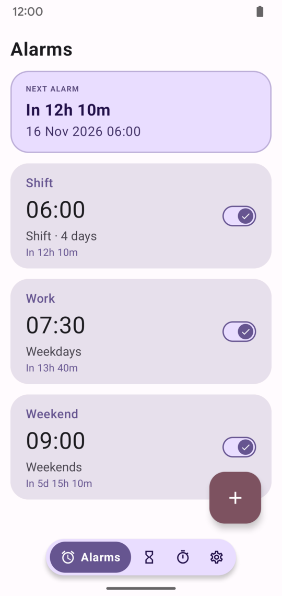
  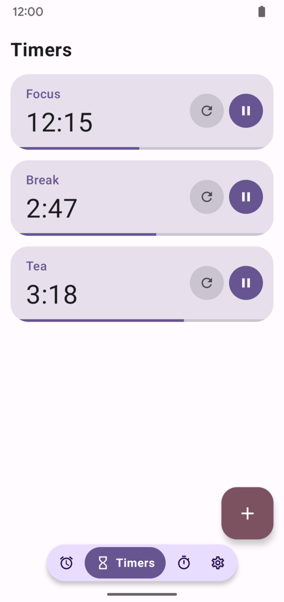
  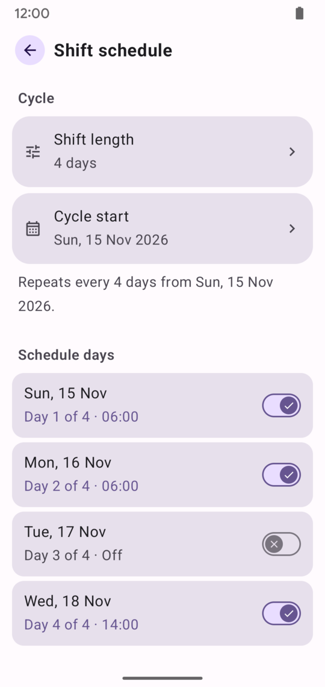
  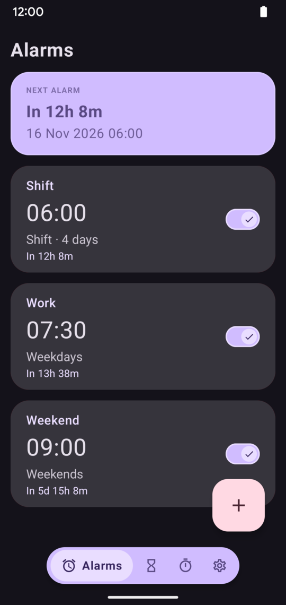
</p>
<p align="center"><sub>Alarms · Timers · Shift schedule · Dark theme</sub></p>

## More screenshots

<details>
<summary>Setup, settings, themes, stopwatch and permissions</summary>

<p align="center">
  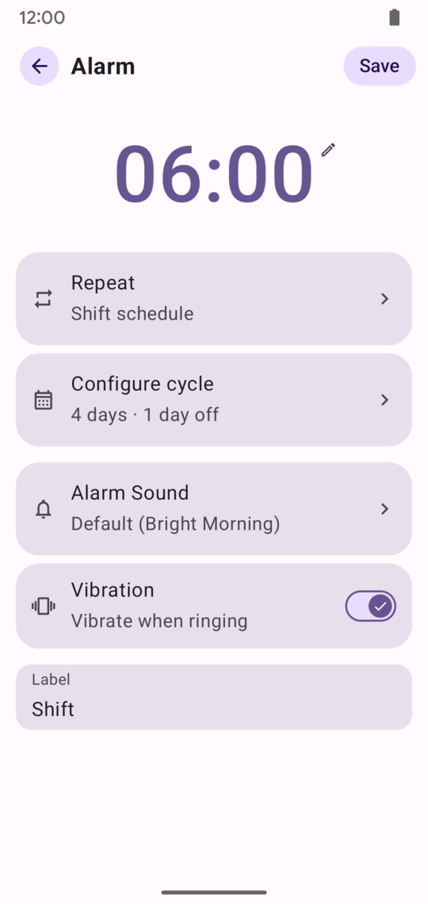
  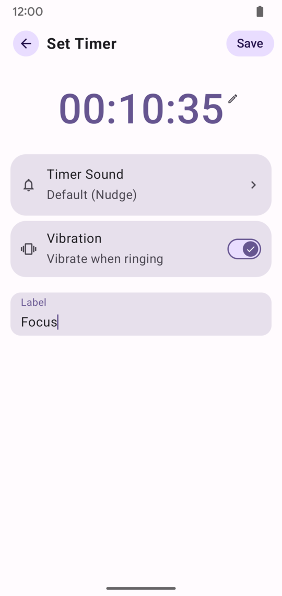
  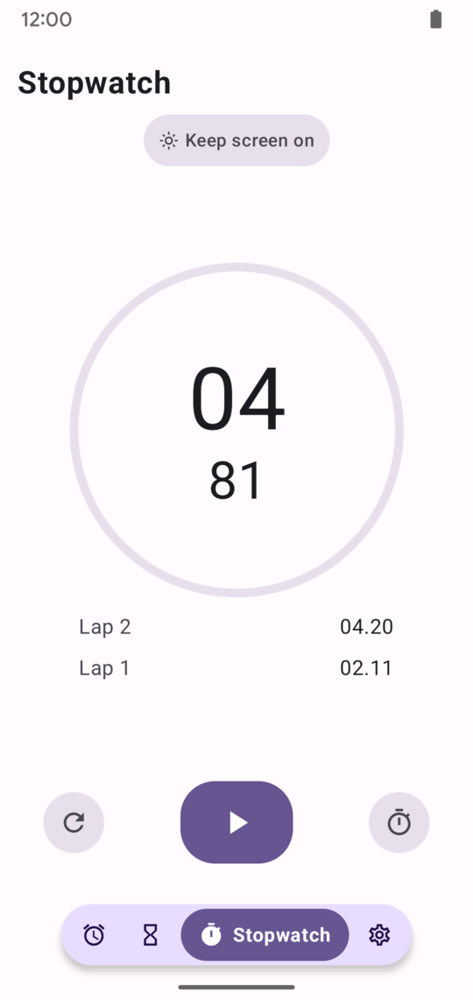
</p>
<p align="center"><sub>Alarm setup · Timer setup · Stopwatch</sub></p>
<p align="center">
  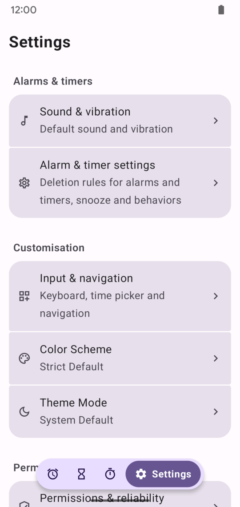
  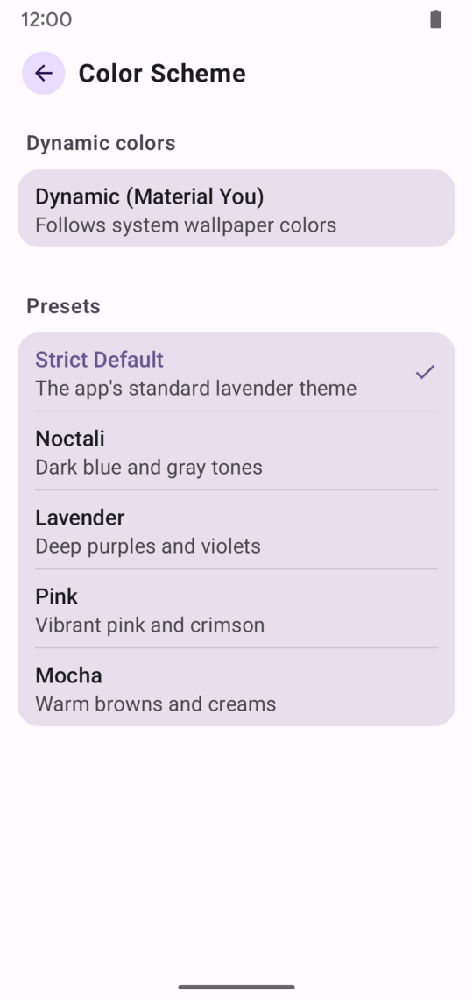
  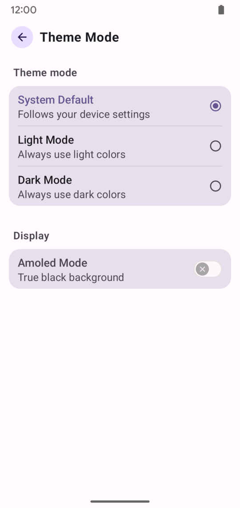
</p>
<p align="center"><sub>Settings · Color schemes · Theme mode</sub></p>
<p align="center">
  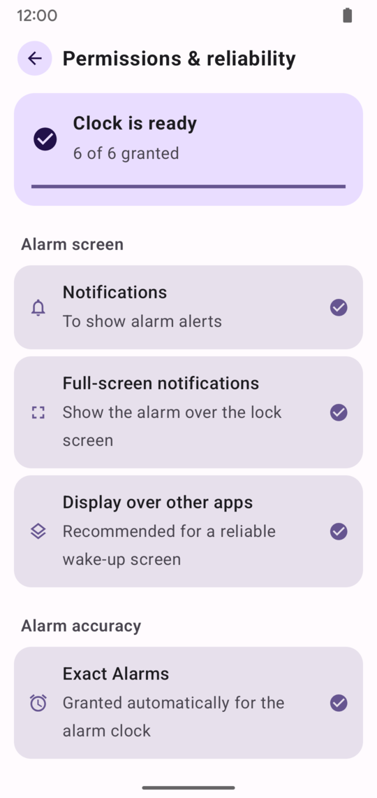
</p>
<p align="center"><sub>Permissions & reliability</sub></p>

<sub>Screenshots from a Xiaomi MI 8 Lite, Android 15.</sub>

</details>

## Highlights

- **Shift schedules — the reason this fork exists.** A cycle can be 1–60 days long, with a start date, a separate time or day off for every day, infinite repetition and a preview of upcoming dates.
- **Multiple timers in one place.** Independent timers with names, `HH:MM:SS`, pause/resume/reset, +1 minute, progress, per-timer sound and vibration, and one notification per timer.
- **Alarms that survive the system.** The alarm and timer logic was rewritten for accurate scheduling and recovery. Alarm and timer state is restored, and they still ring even if Android kills the app.
- **Quiet and offline.** No `INTERNET`, analytics, ads, AI/ML or camera access.
- **Themes and adaptive layout.** Light/dark/system theme, AMOLED, several color schemes, dynamic Material You colors, large-font and tablet layouts, predictive back gesture.
- **Useful extras.** A separate stopwatch tab with laps, a 4×2 date/time widget, and a single **Permissions & background** screen for notifications, exact alarms, full-screen notifications, Display over other apps, battery and Autostart.

### Shift schedules in detail

- Repeat modes: Once, Every day, Weekdays, Weekends, Custom days and Shift schedule.
- Per-day configuration: a time or a day off for every day of the cycle.
- Skip the next trigger without disabling the whole alarm: the switch temporarily turns off and comes back automatically after the skipped date.
- Exact `AlarmManager` alarms, full-screen wake-up and snooze 1–30 minutes.

## Differences from Mascot

**Removed:** wake-up challenges (math, QR, camera, puzzle, flashbang), AI/ML Kit, Zen Mode, Invincible Mode, Anti Power Off, Device Admin, Accessibility, wake-up streak, update checker, 12-hour format, app-icon picker.

**Added:** shift schedules, multiple timers, a separate stopwatch tab, custom wheel time picker, keyboard time input, global sound/vibration defaults with linked overrides, Permissions & background, Clock launcher icon, 4×2 widget, English/Russian localization.

**Rewritten:** the alarm and timer engine. Scheduling, countdown and recovery logic were reworked so alarms and timers stay accurate and can ring even after the system kills the app.

## Download

- [Latest release](https://github.com/DmitryAbramkin/Clock/releases/latest)
- Stable APK link: [Clock.apk](https://github.com/DmitryAbramkin/Clock/releases/latest/download/Clock.apk)
- Versioned builds: `Clock-vX.Y.Z-universal.apk`, always shipped with `SHA256SUMS.txt`

Clock contains no native libraries, so one universal APK works on every supported device. Release builds are signed with the project's debug certificate — the same key as local builds — so they can be installed over each other. This is not a Google Play release.

Verify a download with `sha256sum -c Clock.apk.sha256` (or the matching versioned `.sha256` file).

## Build

- App id: `com.olivka.clock`
- Android 8.0+ (API 26), compile/target SDK 34
- JDK 17, Android SDK Platform 34, Build-Tools 34.0.0

```bash
export ANDROID_HOME="$HOME/Android/Sdk"
export ANDROID_SDK_ROOT="$ANDROID_HOME"

./gradlew testDebugUnitTest lintDebug assembleDebug assembleRelease
```

Release APK: `app/build/outputs/apk/release/app-release.apk` (~2 MB). R8 and resource shrinking, non-debuggable, signed with the local debug certificate. This is a personal build, not a Google Play release.

## Install

```bash
adb install -r app/build/outputs/apk/release/app-release.apk
```

The old `com.hotaro.mascot` package is a separate app; its data is not migrated automatically. A different signing key or package id requires uninstalling the previous build.

## Permissions & background

Clock asks for notifications, exact alarms, full-screen notifications (Android 14+), the optional Display over other apps permission, a battery optimization exemption and background activity. On OEM firmware also enable Autostart. The in-app **Settings → Permissions & reliability** screen shows the current state and opens the relevant system pages. See [dontkillmyapp.com](https://dontkillmyapp.com/) for device-specific instructions.

`INTERNET` is not declared. The app works fully offline.

## Documentation

- [README in Russian](README.ru.md)
- [PROJECT_NOTES.md](PROJECT_NOTES.md) — architecture, data model and diagnostics
- [THIRD-PARTY-NOTICES.md](THIRD-PARTY-NOTICES.md) — licenses and attribution
- [changelog.md](changelog.md) — release history (English)
- [changelog.ru.md](changelog.ru.md) — release history in Russian

Agent skills used during development are vendored in [.opencode/](.opencode/); sources and licenses are listed in [.opencode/SKILLS.md](.opencode/SKILLS.md).

## License and credits

Clock is distributed under the MIT License. The original Mascot copyright notice is preserved in [LICENSE](LICENSE).

- **Mascot** — base application and code, MIT, © 2026 Hotaro.
- **material-clock** — launcher icon base, MIT, © 2026 Rayane Bouafia.
- **AndroidX, Jetpack Compose, Room, Material Icons** — Apache 2.0, © The Android Open Source Project / Google LLC.
- **Kotlin** — Apache 2.0, © JetBrains s.r.o.

The in-app **Licenses** screen contains the full MIT and Apache 2.0 texts. Google, Material, Android and Pixel are trademarks of Google LLC. Clock is not affiliated with or endorsed by Google, Hotaro26 or Rayane Bouafia.
