# Clock

[English](README.md) · **Русский**

<p align="center">
  
</p>

> **Разработка ведётся с помощью нейросетей.** Проект развивается с помощью LLM-агентов (OpenCode). Каждое изменение проверяется, собирается и тестируется автором.

**Clock** («Часы») — личный, сильно модифицированный форк открытого приложения [Mascot](https://github.com/Hotaro26/Mascot) от [Hotaro26](https://github.com/Hotaro26). Это тихий офлайн-будильник с 24-часовым форматом, построенный вокруг **сменных графиков**, с несколькими таймерами, секундомером и аккуратным интерфейсом Material 3.

## С первого взгляда

<p align="center">
  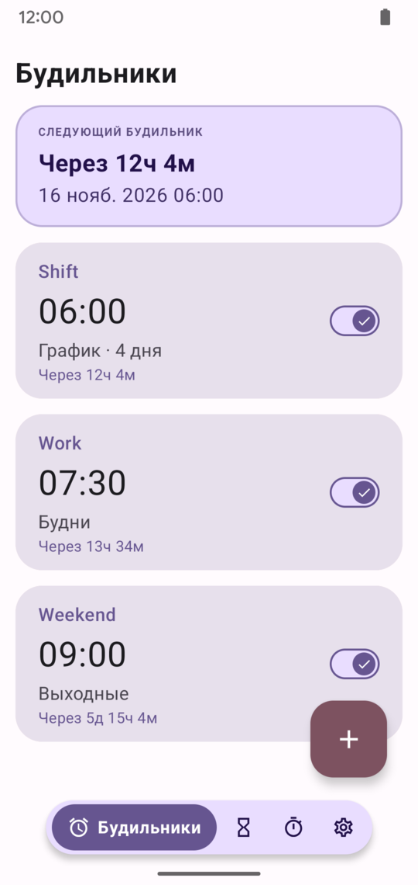
  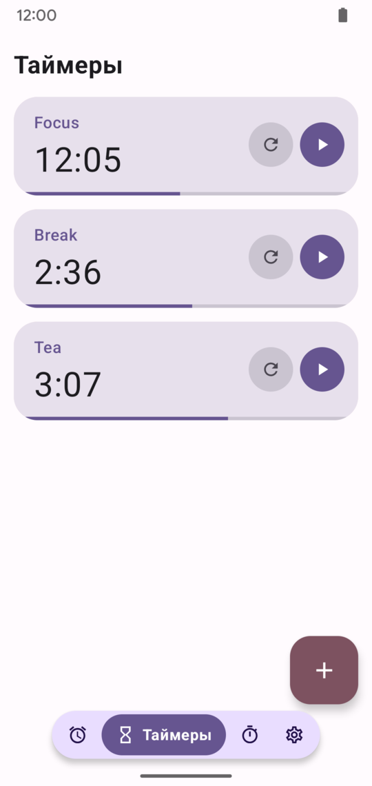
  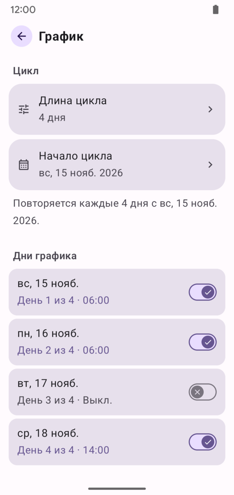
  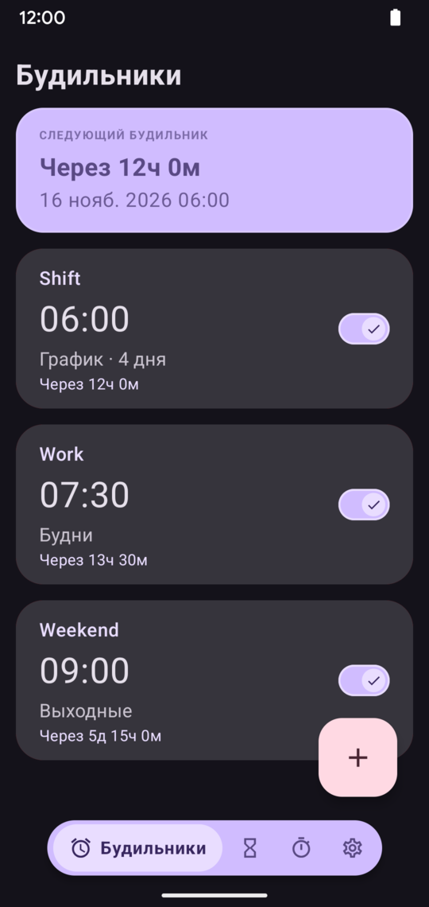
</p>
<p align="center"><sub>Будильники · Таймеры · График смен · Тёмная тема</sub></p>

## Ещё скриншоты

<details>
<summary>Создание будильника и таймера, настройки, темы, секундомер и разрешения</summary>

<p align="center">
  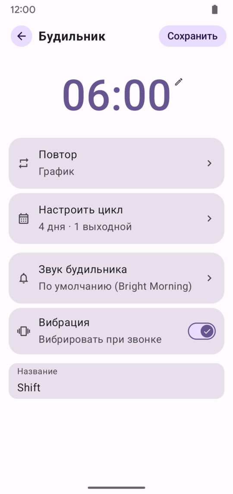
  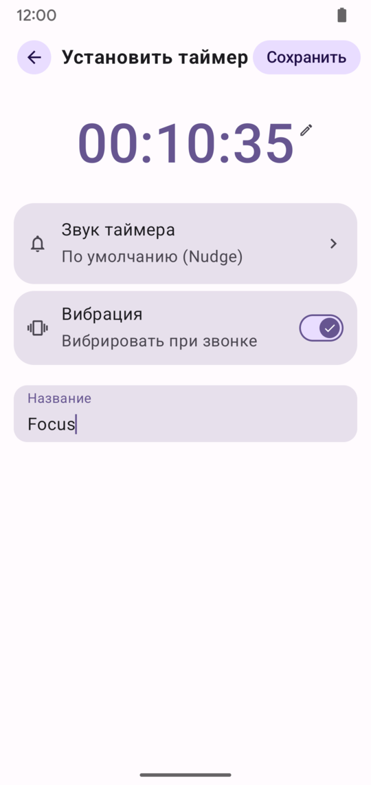
  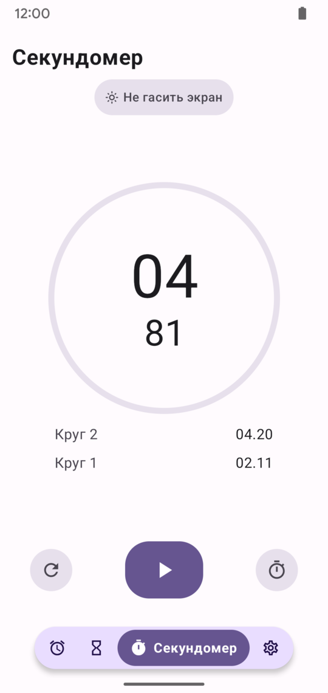
</p>
<p align="center"><sub>Создание будильника · Создание таймера · Секундомер</sub></p>
<p align="center">
  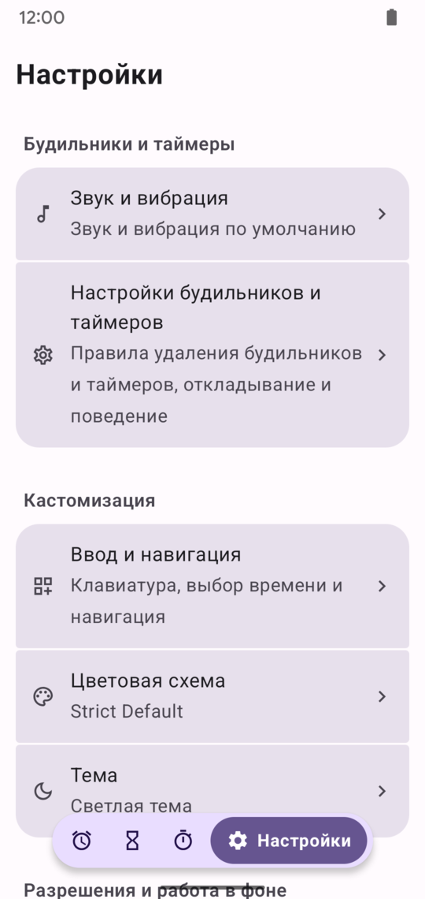
  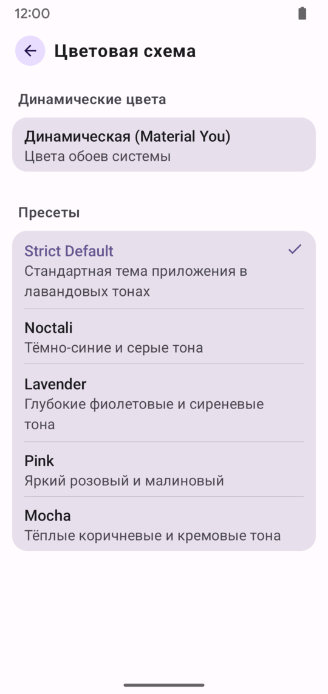
  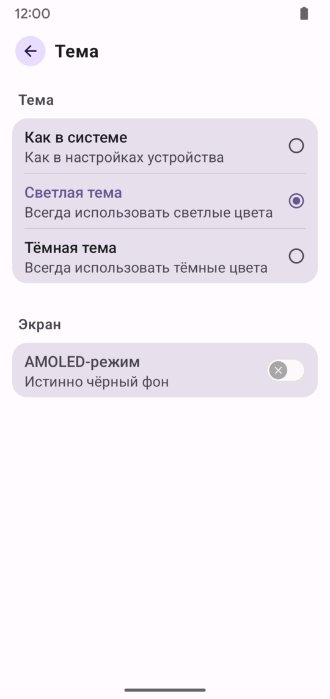
</p>
<p align="center"><sub>Настройки · Цветовые схемы · Тема</sub></p>
<p align="center">
  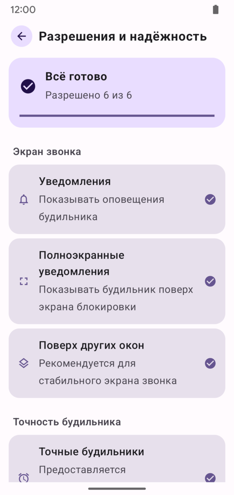
</p>
<p align="center"><sub>Разрешения и надёжность</sub></p>

<sub>Скриншоты с Xiaomi MI 8 Lite, Android 15.</sub>

</details>

## Главное

- **Сменные графики — главная причина этого форка.** Цикл 1–60 дней, дата старта, своё время или выходной для каждого дня, бесконечное повторение и список ближайших дат.
- **Несколько таймеров в одном месте.** Независимые таймеры с названием, `ЧЧ:ММ:СС`, паузой, сбросом, `+1 минутой`, прогрессом, своими звуком и вибрацией и отдельным уведомлением на каждый таймер.
- **Будильники, которые переживают систему.** Логика будильников и таймеров переписана для точного планирования и восстановления. Состояние сохраняется, и они срабатывают, даже если Android убил приложение.
- **Тихо и офлайн.** Нет `INTERNET`, аналитики, рекламы, AI/ML и доступа к камере.
- **Темы и адаптивность.** Светлая/тёмная/системная тема, AMOLED, несколько цветовых схем, динамические цвета Material You, поддержка крупного шрифта, планшетная навигация, жест возврата.
- **Полезные мелочи.** Отдельная вкладка секундомера с кругами, виджет 4×2 с датой и временем и единый экран **«Разрешения и работа в фоне»** для уведомлений, точных будильников, полноэкранных уведомлений, разрешения «Поверх других окон», батареи и автозапуска.

### Сменные графики подробнее

- Режимы повтора: один раз, каждый день, будни, выходные, выбранные дни и график.
- Для каждого дня цикла можно задать своё время или выходной.
- Пропуск ближайшего срабатывания без отключения будильника: переключатель временно выключается и сам включается после пропущенной даты.
- Точные будильники через `AlarmManager`, полноэкранный режим звонка и откладывание 1–30 минут.

## Отличия от Mascot

**Удалено:** челленджи пробуждения (математика, QR, камера, пазлы, вспышка), AI/ML Kit, режимы Zen, Invincible и Anti Power Off, права администратора устройства и специальных возможностей, серия пробуждений, проверка обновлений, 12-часовой формат, выбор иконок.

**Добавлено:** сменные графики, несколько таймеров, отдельная вкладка секундомера, собственный колёсный таймпикер, клавиатурный ввод времени, глобальные настройки звука и вибрации с наследованием и переопределением, раздел «Разрешения и работа в фоне», иконка Clock, виджет 4×2, русская и английская локализация.

**Переписано:** логика будильников и таймеров. Расчёт следующего срабатывания, отсчёт и восстановление переработаны, чтобы будильники и таймеры оставались точными и срабатывали даже после того, как система убила приложение.

## Скачать

- [Последний релиз](https://github.com/DmitryAbramkin/Clock/releases/latest)
- Стабильная ссылка на APK: [Clock.apk](https://github.com/DmitryAbramkin/Clock/releases/latest/download/Clock.apk)
- Версионные сборки: `Clock-vX.Y.Z-universal.apk` вместе с `SHA256SUMS.txt`

В Clock нет нативных библиотек, поэтому один универсальный APK подходит для всех поддерживаемых устройств. Release подписан debug-сертификатом проекта — тем же ключом, что и локальные сборки, поэтому сборки можно устанавливать поверх друг друга. Это не сборка для Google Play.

Проверка скачанного файла: `sha256sum -c Clock.apk.sha256` (или `.sha256` рядом с версионным APK).

## Сборка

- Package id: `com.olivka.clock`
- Android 8.0+ (API 26), compile/target SDK 34
- JDK 17, Android SDK Platform 34, Build-Tools 34.0.0

```bash
export ANDROID_HOME="$HOME/Android/Sdk"
export ANDROID_SDK_ROOT="$ANDROID_HOME"

./gradlew testDebugUnitTest lintDebug assembleDebug assembleRelease
```

Release APK: `app/build/outputs/apk/release/app-release.apk` (~2 МБ). R8 и сжатие ресурсов, не debuggable, подписан локальным debug-сертификатом. Это персональная сборка, не для Google Play.

## Установка

```bash
adb install -r app/build/outputs/apk/release/app-release.apk
```

Старый пакет `com.hotaro.mascot` считается отдельным приложением; его данные автоматически не переносятся. Другая подпись или package id требуют удаления предыдущей сборки.

## Разрешения и работа в фоне

Clock запрашивает уведомления, точные будильники, полноэкранные уведомления (Android 14+), при желании разрешение «Поверх других окон», исключение из оптимизации батареи и фоновую активность. На OEM-прошивках также включите автозапуск. Экран **Настройки → Разрешения и надёжность** показывает текущий статус и открывает нужные системные страницы. Инструкции для конкретных устройств — на [dontkillmyapp.com](https://dontkillmyapp.com/).

`INTERNET` не объявлен. Приложение работает полностью офлайн.

## Документация

- [README на английском](README.md)
- [PROJECT_NOTES.md](PROJECT_NOTES.md) — архитектура, данные и диагностика
- [THIRD-PARTY-NOTICES.md](THIRD-PARTY-NOTICES.md) — лицензии и атрибуция
- [changelog.md](changelog.md) — история версий на английском
- [changelog.ru.md](changelog.ru.md) — история версий

Скиллы агентов, использованные при разработке, лежат в [.opencode/](.opencode/); источники и лицензии — в [.opencode/SKILLS.md](.opencode/SKILLS.md).

## Лицензия и авторы

Clock распространяется по лицензии MIT. Оригинальное уведомление об авторских правах Mascot сохранено в [LICENSE](LICENSE).

- **Mascot** — базовое приложение и код, MIT, © 2026 Hotaro.
- **material-clock** — основа иконки приложения, MIT, © 2026 Rayane Bouafia.
- **AndroidX, Jetpack Compose, Room, Material Icons** — Apache 2.0, © The Android Open Source Project / Google LLC.
- **Kotlin** — Apache 2.0, © JetBrains s.r.o.

Полные тексты MIT и Apache 2.0 доступны на экране **Лицензии** в приложении. Google, Material, Android и Pixel — товарные знаки Google LLC. Clock не связан с Google, Hotaro26 или Rayane Bouafia и не одобрен ими.
